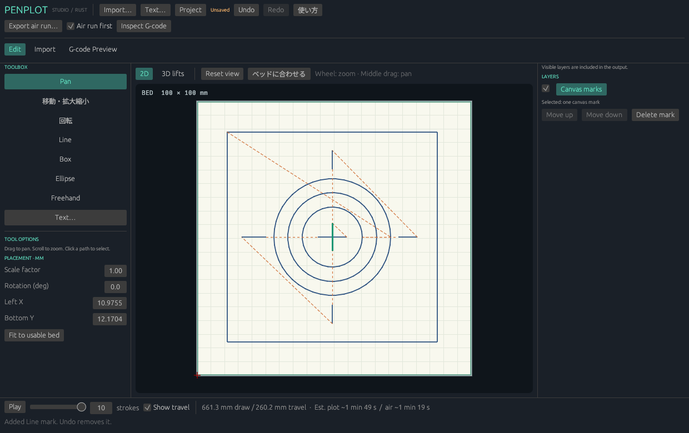
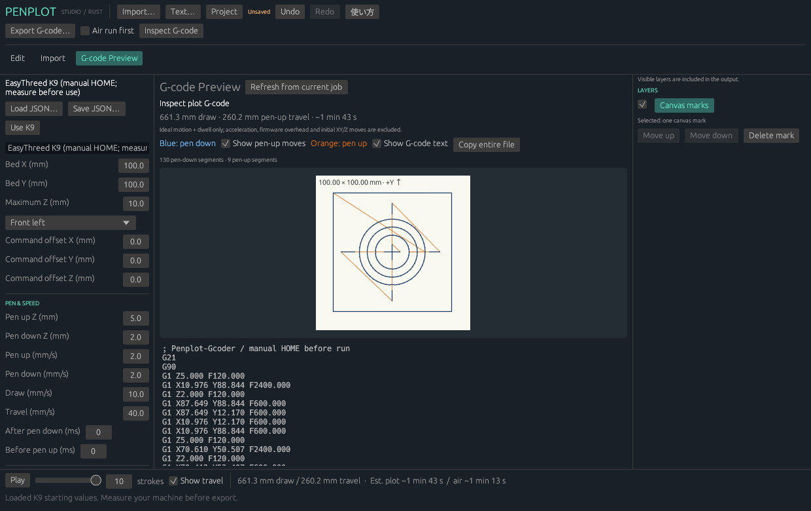
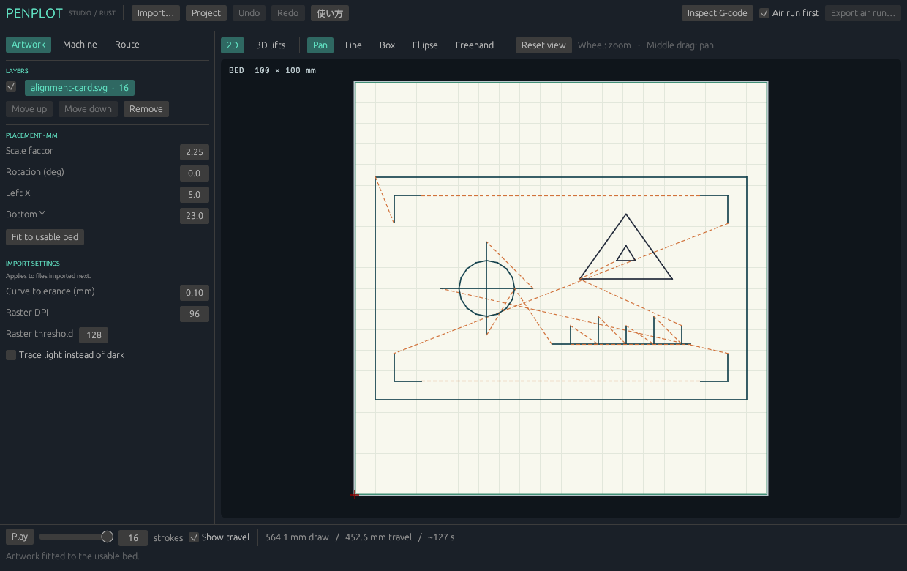

# Penplot-Gcoder Studio

SVG・DXF・画像を読み込み、3D プリンター用のペン描画経路を編集・検査して `.GCODE` に保存するオフラインの Rust デスクトップアプリ。Windows 向け GUI と、GUI なしで同じファイルを生成できる CLI がある。**Python・クラウド・プリンターへの接続は不要**。

## ダウンロード

[最新版の Windows x64 配布版](https://github.com/Xenoah/Penplot-Gcoder/releases/latest) ／ [v0.8.0 の使い方](https://github.com/Xenoah/Penplot-Gcoder/blob/v0.8.0/README.md)

## v0.5.0 の実画面（Linux 版）

次の 2 枚は、v0.5.0 の Linux 版で撮影した画面です。この下にある `main` のソースからの手順・画面例は、旧版 v0.1.0 向けです。







## まず試す（実機なし）

1. Windows x64 ビルドの `penplot-studio.exe` を起動。ソースからは下記 `cargo run`。同梱の `examples/alignment-card.svg` を画面にドロップする。
2. **Artwork** で配置・回転・レイヤー順を変え、**Route** で輪郭だけ／平行ハッチ／クロスハッチを比較する。実線が描画、破線がペン上げ移動。タイムラインでストローク順を追える。**3D lifts** は機械設定の上下 Z とストローク間のリフトを固定視点で立体表示し、Z は 1〜12 倍に誇張できる（[画面例](docs/studio-lifts.png)）。実機の干渉判定ではない。
3. 外枠は原寸 40 × 24 mm。**Fit** は余白を残して拡縮するので、原寸のまま使うなら Scale = 1。図形は回転→拡縮し、回転後外接枠の左下を紙面 X/Y に合わせる。
4. ファイルを実機で使う段階で、**Machine** に接触・退避 Z、送り、実際の可動範囲と取付補正を入力する。確認チェックを入れ、先に **Export air run…** で全経路ペン上げの空走ファイルを出力する。[K9 の実測・手動 HOME・初回テスト](docs/K9.md)

### ソースからビルド

Rustup とプラットフォームの C/C++ リンカーを準備する（Windows は Rust MSVC + Visual Studio Build Tools の C++ ワークロード）。リポジトリの `rust-toolchain.toml` が Rust 1.90.0 を選択し、`Cargo.lock` が依存関係を固定する。初回ビルドは依存関係をダウンロードする。実行時のネット接続は不要。

```sh
cargo run --locked --release --bin penplot-studio
cargo build --locked --release --bins
# ヘッドレス：egui / ウィンドウシステムなし
cargo build --locked --release --no-default-features --bin penplot
```

Windows 出力は `target/release/penplot-studio.exe` と `penplot.exe`。Linux GUI は X11 または Wayland と OpenGL を使用。Linux のネイティブファイルダイアログにはデスクトップポータルが必要。GitHub Actions の **Rust workstation** は Windows と Linux を検査し、成功した Windows ジョブの Artifacts に exe を置く（Release の自動公開はしない）。

## 入力と編集

| 入力 | Rust 版での扱い |
|---|---|
| SVG | viewBox・物理単位・グループ変換・ベジェ/円弧を展開。1 CSS px = 25.4/96 mm。独立したサブパスを結ばない。テキストはパスへ、画像・クリップ・マスク・フィルタ等は事前に輪郭化。省略の警告を確認する。|
| ASCII DXF | モデル空間の LINE、ARC、CIRCLE、ELLIPSE、2D POLYLINE／LWPOLYLINE（bulge）、2D SPLINE（制御点・ノットを持つ 1〜8 次の多項式／有理曲線）。フィット点だけのスプラインは対象外。$INSUNITS を mm に換算し、未指定時は mm として警告。バイナリ DXF、INSERT、3D/メッシュは対象外。|
| PNG / JPEG | DPI と輝度しきい値（反転可能）で黒領域の**外周・穴**を抽出。暗線の中心線ではなく、画素セルの境界を描く。透明部分は白、図の Y 軸を上向きに変換。画像の EXIF 回転・DPI メタデータは自動適用しない。|

- ファイルごとのレイヤー表示・順序・削除、線／矩形／楕円／フリーハンド、Undo/Redo。複数ファイルは元座標で重ねて配置する。
- **Project → Save / Open** で複数レイヤー、描き加えた図形、配置・描画条件と機械設定を単一の `.penplot` に保存する。元画像へのリンクではなく抽出後の形状を格納し、ファイルの再配置や別 PC でも再開できる。機械の校正確認は保存せず、開き直すと未確認に戻る。
- ハッチは閉じた塗り領域に限定し、同一グループの穴を偶奇則で除く。近い線を勝手につながない。最適化は同じレイヤーの連続区間で並び替え・開線の逆転を試みる。
- 入力は 16 MiB まで（ベクターは 8 MiB）、画像は 8 MP、ドキュメント全体は 50 万頂点・10 万経路まで。さらに曲線／ハッチ密度による処理上限あり。形状が重すぎる場合は簡略化するかハッチの間隔を広げる。
- **紙面と機械の両方で範囲を検証**。問題があれば保存をブロックする。出力は mm・絶対座標、送り F は mm/min。発熱・押出・自動 HOME・モーター解放は行わない。

## CLI

```sh
# 機械に触れずにプリフライト。変換結果をファイルに保存しない
penplot check --x 5 --y 5 examples/alignment-card.svg

# 機種名付きの編集用ひな型を書き出す（値は未校正）
penplot profile-init measured.json --k9
# ここで measured.json を実機の測定値に合わせる

# 手動で HOME し、可動域・Z・オフセットを実測した後のみ
penplot convert --profile measured.json --calibrated --air-run --x 5 --y 5 -o AIRRUN.GCODE examples/alignment-card.svg
penplot convert --profile measured.json --calibrated --x 5 --y 5 -o PLOT.GCODE examples/alignment-card.svg

# DXF 回転＋余白、SVG クロスハッチ等を実機なしで比較
penplot check --rotate 90 --fit 5 examples/calibration.dxf
penplot check --hatch cross --spacing 1 --angle 45 --optimize examples/alignment-card.svg

# Studio で保存した編集結果を、同じ設定・可視レイヤーで変換
penplot check my-job.penplot
penplot convert --calibrated --air-run -o JOBAIR.GCODE my-job.penplot
penplot --help
```

CLI は既存ファイルを上書きしない。エラー時に G-code を部分保存しない。GUI も CLI も同じライブラリで変換し、同じ条件なら出力バイト列は同じ（時刻や入力パスを埋め込まない）。

## 旧版から移行する

`profiles/printers/*.json` の同梱 4 機種は **Load JSON…** または `penplot profile-migrate profiles/printers/K9.json measured.json` で読み込める。**サイズ・原点・XY オフセットのみ**を引き継ぎ、Z・速度・生の G-code テンプレート・ファーム指定・経路設定は流用しない。旧 K9 の空のペン指令、同値の昇降 Z、0.1 mm/s、Klipper 指定を有効な純正機の設定として扱わない。Rust 版の保存形式はバージョン付き JSON。

旧 Python 版の `main.py`・`src/`・既存プロファイルは手を加えず残している。旧 `setup.bat` は **Python 版**を起動する。Rust 版で未移植なのは3D ビューの自由回転（固定等角投影は対応）、2-opt、ドット・スパイラル等の特殊塗り、自由な開始／終了テンプレート、色別ペン交換の機械命令など。現在は **Z 軸リフト専用・ファイル出力のみ**で、FAN/サーボ・USB ストリーム・K9 実機動作は未検証。

## 開発と検証

```sh
cargo fmt --all -- --check
cargo clippy --locked --all-targets --all-features -- -D warnings
cargo test --locked --all-features
cargo test --locked --no-default-features
cargo build --locked --release --bins
```

Rust の入口は `src-rs/lib.rs`（変換）、`src-rs/desktop.rs`（GUI）、`src-rs/cli.rs`（CLI）。`tests/pipeline.rs` は実ファイル、穴付き塗り、配置、空走、上書き拒否、同一出力を検査する。
