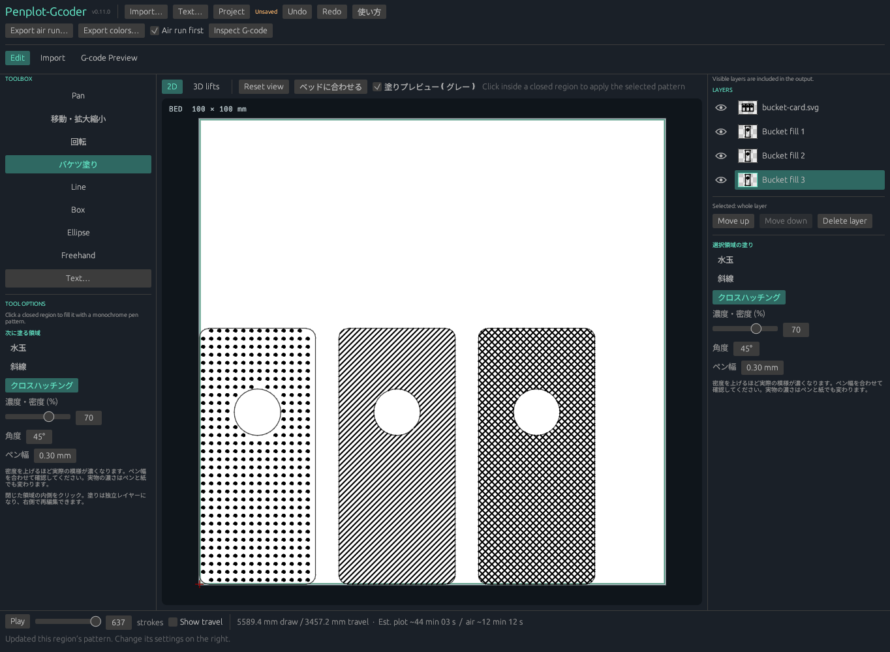
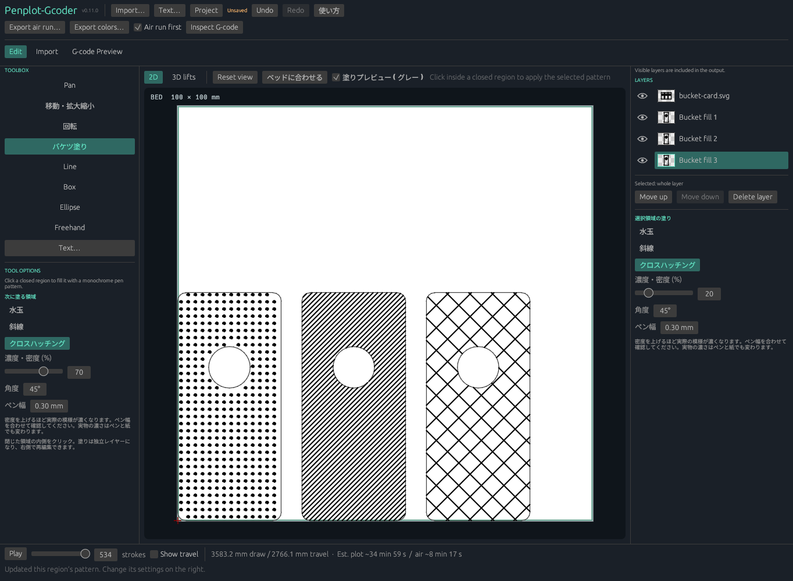

# Penplot-Gcoder v0.11.0 — バケツでパターン塗り

Edit のバケツで閉じた領域をクリックすると、水玉・斜線・クロスハッチングのペン描画経路を作れます。領域ごとに密度を変え、出力前に白い紙の上でグレースケールの仕上がりを確認できます。

右のクロスハッチだけを20%へ下げた同じ文書です。

- 閉じた面・接続した線・交点・共有辺から領域を選び、穴を塗り残します。開いた輪郭は自動でつなぎません。
- 水玉は短い連続らせんで内側まで描き、斜線・クロスハッチはペン幅と密度から間隔を計算します。密度100%は相対的な最大値で、完全な黒を保証する値ではありません。
- 塗りは独立レイヤー。再編集、Undo/Redo、移動・拡縮、保存・再読込に対応します。元の線画を変えたときは塗りを作り直してください。
- パターン付き文書は保存形式v5。v1〜v4の読み込み、旧取り込みモード、色別出力、K9の設定を維持します。
- 紙端に置いたハッチの浮動小数点誤差による範囲外判定を修正しました。機械の可動範囲検証は維持しています。

[日本語操作ガイド](../BUCKET-FILL.ja.md)

## 検証

Linuxで全機能137件、GUIなし80件、Clippy（警告をエラー扱い）、fmt、releaseビルドを確認。実アプリでSVGの読み込み、バケツによる3領域の塗り分け、密度70→20%の変化、穴抜き、Undoを操作確認しました。上のPNGは同じ環境の実アプリウィンドウの撮影で、合成やモックではありません。

自動テストでは穴・開いた境界・共有辺・各パターンの密度・紙端・保存再読込・CLIによる実G-code一致・選択レイヤー移動・既存画像とK9設定を検証しています。

この作業環境にはLinuxのファイル選択ポータルがないため、ネイティブの保存ダイアログ完了は未確認です。保存と再読込の処理およびCLI出力はテスト済み。Windows CI、Windows実画面、実機での濃淡・動作は別途確認が必要です。
