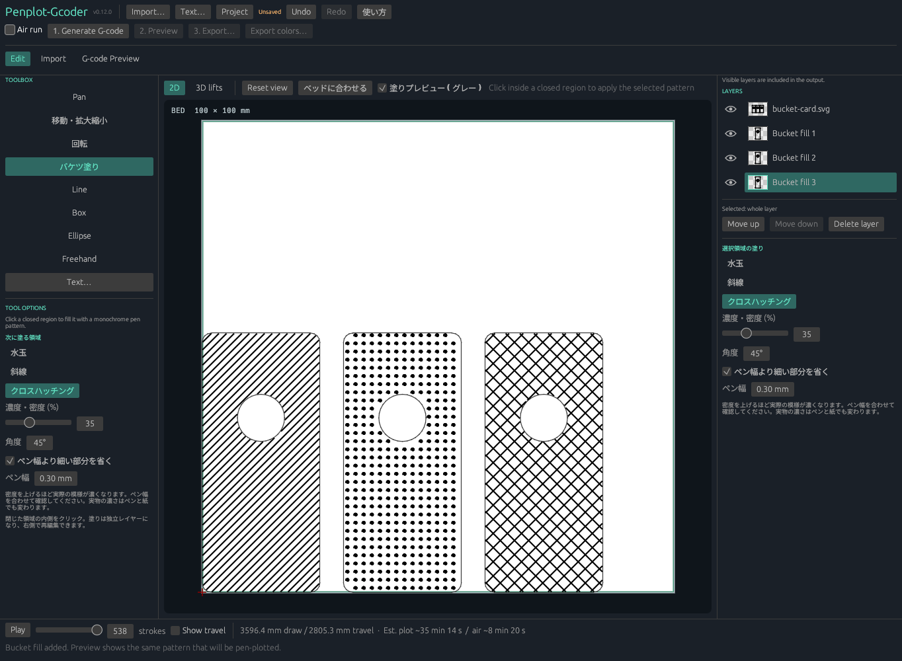
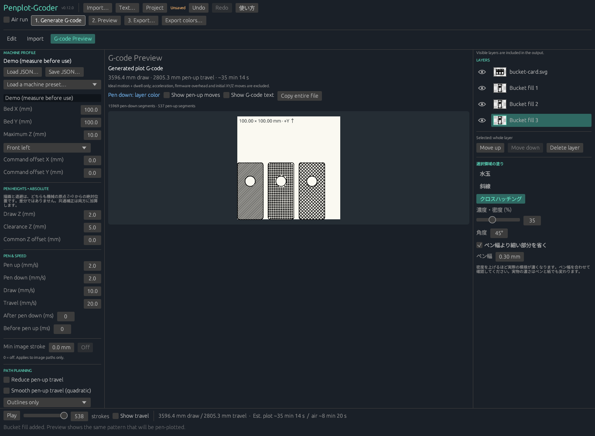

# Penplot-Gcoder v0.12.0 — ペン幅で省略・生成してからプレビューと保存

- PNG/JPEG取り込みにペン幅フィルターを追加。長くてもペンより細い線や枝を省き、Outline・Centerline・Clean line art・Color hatchに対応します。
- バケツの斜線／クロスハッチは外周・穴からペン半径ぶん離して描画し、狭い部分を省略します。新規のバケツ塗りではオン、既存プロジェクトは設定を維持します。
- **1. Generate G-code → 2. Preview → 3. Export** に変更。生成したコマンドをプレビューして同じ内容を保存します。編集後やAir run切替後は再生成が必要です。
- CLIに `--pen-width MM` を追加。新しいペン幅設定を使うプロジェクトはv6形式、設定を使わない旧形式も保持します。

[操作方法と制限](../PEN-WIDTH.ja.md)

画像の幅判定は取り込みDPI基準です。取り込み後の拡縮では再解析しないため、最終寸法に合うDPIで再取り込みしてください。SVG/DXFなどの開いた中心線から元の線幅は推定しません。塗りの余白は拡縮後の紙上mmで計算します。

## 検証

Linuxの全機能テスト143件・GUIなし84件、clippy、fmt、releaseビルドが成功。細い長線、太い線、枝、穴、各画像モード、保存・再読込、CLI出力一致、生成前／編集後のExport無効化を確認しました。Linux実アプリで3パターン塗り、ペン幅設定、GenerateからPreviewへの遷移、編集後のExport無効化と再生成を確認しました。スクリーンショットは同梱の合成素材による当該版の実画面です。WindowsのGUI、Linuxの保存ダイアログ（デスクトップポータル未導入）、実機描画は未検証です。
